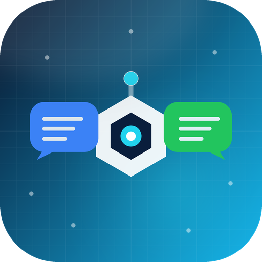

# multi-bot-adapter




> **把聊天平台协议收敛成一套可复用的渠道适配器。**
> QQ 官方 Bot 与微信 wxclaw / iLink Bot 的扫码登录、收消息、发文本、富媒体、语音、
> 产物投递、管理员命令、定时推送和协议排错，一次接清楚。

---

## 它解决什么问题

多渠道机器人接入的难点通常不在「调一个接口」，而在这些反复踩的坑：

| 会踩的坑 | 典型后果 | 本 skill 在哪说明 |
|---|---|---|
| wxclaw 缺 `AuthorizationType` 头 | 一律 `-14 session timeout`，无法定位 | `references/wxclaw-integration.md` |
| QQ 被动回复没带 `msg_id` | 群聊 403 / 不回复 | `references/qqbot-integration.md` |
| QQ token 没缓存 | 频繁鉴权失败、触发限流 | 同上 |
| `upload_param` 只看 `data` | 永远「获取上传地址失败」 | wxclaw 媒体章节 |
| AES key 尝试顺序错 | 偶发文件乱码 | wxclaw 解密章节 |
| 附件只看扩展名 | 语音被当文件、图片丢失 | QQ 入站解析章节 |
| 重连/游标回退 | 同一条消息回复两次 | 两个渠道的去重章节 |
| 语音失败整条消息丢 | 用户只看到文本或什么都没有 | `references/adapter-contract.md` |

---

## 覆盖范围

| 主题 | 内容 | 文件 |
|---|---|---|
| 总体架构 | 适配器 / BaseAdapter / Manager 三层职责 | `SKILL.md` |
| 适配器契约 | 标准消息、基类方法、dispatch 顺序、生命周期 | `references/adapter-contract.md` |
| 协议速查 | 端点、请求头、payload、媒体映射并排对比 | `references/protocol-cheatsheet.md` |
| QQ 官方 Bot | 扫码、token、WebSocket、文本、富媒体、语音、排错 | `references/qqbot-integration.md` |
| 微信 wxclaw | 扫码、请求头、长轮询、加密上传/下载、排错 | `references/wxclaw-integration.md` |
| 渠道运行时 | 会话、产物、管理员、工作流、推送、状态 | `references/adapter-contract.md` |

---

## 目录结构

```
multi-bot-adapter/
├── SKILL.md                          # 入口：何时用、架构、接入流程、必守不变量
├── README.md
├── CHANGELOG.md
├── .github/workflows/release.yml     # tag 触发：校验、打包、创建 GitHub Release
├── agents/openai.yaml                # 平台展示配置
├── .codex-plugin/plugin.json         # Codex 插件元数据
├── assets/
│   ├── icon-1024.png                 # 技能图标（1024）
│   ├── icon-512.png                  # 平台展示图标（512）
│   ├── icon-256.png
│   └── icon-128.png
├── scripts/package_skill.py          # 本地与 CI 共用的打包脚本
├── tools/make_icon.py                # 本地矢量图标生成脚本（可复现/改色）
└── references/
    ├── qqbot-integration.md          # QQ 全量接入指南
    ├── wxclaw-integration.md         # 微信全量接入指南
    ├── protocol-cheatsheet.md        # 一页协议速查
    └── adapter-contract.md           # 适配器契约 + Manager 运行时
```

---

## 安装

把整个 `multi-bot-adapter/` 目录复制到目标 agent 的 skills 目录：

| Agent | 用户级目录 |
|---|---|
| Claud / Claud Code | `~/.claud/skills/multi-bot-adapter/` |
| Codex | `~/.codex/skills/multi-bot-adapter/` |
| 通用 Agent Skills | `~/.agents/skills/multi-bot-adapter/` |

Windows 的 `~` 是 `C:\Users\<用户名>\`。

项目级安装可放到 `<项目>/.claud/skills/multi-bot-adapter/`。

---

## 使用

安装后，直接描述任务即可触发，例如：

- 「给这个 agent 框架接入 QQ 官方机器人，支持群聊和私聊」
- 「微信 wxclaw 一直 -14，帮我排查请求头」
- 「QQ 机器人发语音失败，改成发文件并补文本」
- 「照着现有渠道实现第三个平台，复用会话和产物能力」
- 「扫码登录成功后 token 没保存，检查回填逻辑」

也可以显式调用：

```
$multi-bot-adapter 按适配器契约接入这个新渠道，并给出测试清单
```

---

## 版本

- **1.0.0**（2026-11-06）：首个版本。基于已跑通的 QQ 官方 Bot 与微信 wxclaw
  适配器实现整理，包含扫码登录、协议收发、媒体/语音、渠道运行时与排错清单。

详见 `CHANGELOG.md`。

---

## 打包与发布

### 本地打包

```bash
# 只校验
python scripts/package_skill.py --check-only

# 生成 dist/
python scripts/package_skill.py --out dist
```

产出：

| 文件 | 用途 |
|---|---|
| `multi-bot-adapter-1.0.0.skill` | Claud / Claud Code 技能包（zip，SKILL.md 在根） |
| `multi-bot-adapter-1.0.0.zip` | 通用分发包 |
| `multi-bot-adapter-1.0.0-codex-plugin.zip` | Codex 插件布局（`.codex-plugin/` + `skills/`） |
| `sha256sums.txt` | 校验和 |

### 发布新版本

1. 修改 `SKILL.md` 的 `version`，同步 `.codex-plugin/plugin.json` 与 `CHANGELOG.md`。
2. 提交并推送：
   ```bash
   git add .
   git commit -m "chore: release v1.2.3"
   git push origin main
   ```
3. 打 tag 并推送，工作流会自动校验并发布：
   ```bash
   git tag v1.2.3
   git push origin v1.2.3
   ```

工作流（`.github/workflows/release.yml`）会：

- 校验 tag（`v1.2.3`）与 `SKILL.md` 版本一致
- 跑 `scripts/package_skill.py --check-only`
- 构建 `.skill`、`.zip`、Codex 插件包和 `sha256sums.txt`
- 上传为 workflow artifact
- 创建或更新 GitHub Release，并把所有包作为 Release 资产

也可以手动触发：Actions → Release → Run workflow，填入已存在的 tag。

> tag 与 `SKILL.md` 版本不一致时工作流会直接失败，避免发错版本。

---

## 作者

bucai2417
